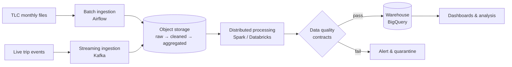
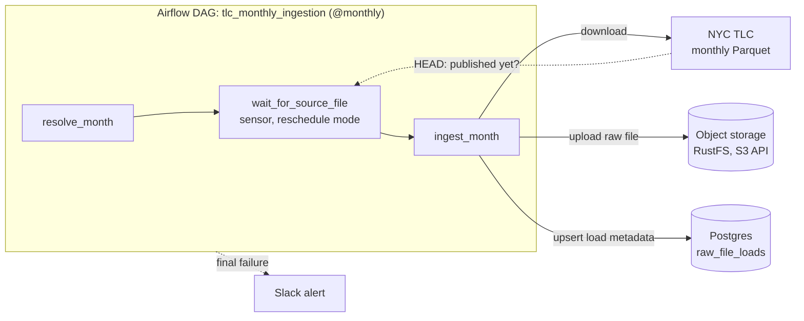

# NYC Mobility Platform

[](https://github.com/reaksmeylim07/nyc-mobility-platform/actions/workflows/ci.yml)

An end-to-end data platform that ingests, processes, and validates New York City
taxi and for-hire vehicle trip data to deliver reliable, analysis-ready datasets
on urban mobility demand, revenue, and congestion patterns.

## The Problem

NYC's Taxi & Limousine Commission publishes hundreds of millions of trip records
as monthly files. Raw, the data is large, inconsistently typed, and contains
invalid records (negative fares, impossible trip durations, missing locations).
It cannot be trusted or queried efficiently as-is.

This platform turns those raw files, plus a simulated real-time trip event feed,
into clean, tested, versioned datasets that can answer questions such as:

- **Demand:** Which zones have the highest pickup demand by hour and day of week?
- **Revenue:** How do fares and tips vary by zone, time, and payment type?
- **Congestion:** Where and when do average trip speeds drop the most?
- **Airports:** How does airport trip volume and pricing trend over time?

## What the Platform Delivers

| Capability | Description |
|---|---|
| Automated ingestion | Scheduled batch loads of monthly trip files, plus streaming ingestion of live trip events |
| Layered storage | Raw → cleaned → aggregated data zones in object storage, using open table formats |
| Scalable processing | Distributed transformations that handle billions of rows |
| Data quality gates | Data contracts that block invalid data before it reaches consumers |
| Reproducible infrastructure | All cloud resources defined as code; the full stack runs locally with one command |

## Data Sources

| Source | Type | Description |
|---|---|---|
| [NYC TLC Trip Record Data](https://www.nyc.gov/site/tlc/about/tlc-trip-record-data.page) | Batch (monthly Parquet) | Yellow taxi, green taxi, and for-hire vehicle trips |
| Taxi Zone Lookup | Reference (CSV) | Maps location IDs to borough and zone names |
| Simulated trip events | Streaming | Synthetic real-time trip events generated from historical patterns |

## Architecture (target)



## Tech Stack

| Layer | Tool | Status |
|---|---|---|
| Containerization | Docker, Docker Compose | ✅ Done (local) |
| Object storage | RustFS (local, S3 API) / GCS (cloud) | 🚧 Local done, cloud planned |
| Metadata store | PostgreSQL | ✅ Done (local) |
| Orchestration | Apache Airflow 3 (LocalExecutor) | ✅ Done (local) |
| Packaging & dependencies | uv, lockfile, installable `nyc_mobility` package | ✅ Done |
| Testing & code quality | pytest, ruff, pre-commit, DAG integrity tests | ✅ Done |
| CI/CD | GitHub Actions (lint, tests, Docker build, DAG integrity) | ✅ CI done |
| Alerting | Airflow failure callbacks → Slack webhook | ✅ Done (local) |
| Infrastructure as Code | Terraform | 🔜 Planned |
| Table format | Delta Lake | 🔜 Planned |
| Processing | Apache Spark, Databricks | 🔜 Planned |
| Streaming | Apache Kafka | 🔜 Planned |
| Transformation | dbt | 🔜 Planned |
| Data Quality | Soda / Great Expectations | 🔜 Planned |

## Current State



An Airflow DAG ingests one month of NYC taxi trips per run:

1. **`resolve_month`** decides which month to load: the `year_month` parameter
   for manual runs, otherwise the run's data interval (scheduled runs and backfills).
   Invalid input fails immediately, without retries.
2. **`wait_for_source_file`** is a sensor that checks with an HTTP `HEAD` request
   whether the provider has published the file yet. It re-checks every 6 hours
   for up to 60 days, releasing its worker slot between checks.
3. **`ingest_month`** downloads the file, lands it unchanged in the raw zone of
   object storage, and records the load in Postgres.

Raw files use Hive-style keys, for example:

```
raw/yellow_tripdata/year=2024/month=01/yellow_tripdata_2024-01.parquet
```

The pipeline is **idempotent**: re-running a month overwrites the same object and
updates the same metadata row, so retries and backfills never create duplicates.
Transient failures are retried with exponential backoff; a final failure posts an
alert to Slack.

## Roadmap

- [x] **Phase 1 — Local environment:** containerized services, local orchestration, first batch ingestion
  - [x] Containerized ingestion job
  - [x] Postgres and S3-compatible object storage via Docker Compose
  - [x] Idempotent raw-zone ingestion of monthly TLC files
  - [x] Installable package, lockfile, unit tests and CI
  - [x] Airflow orchestration with retries, backfills, source sensor and alerting
- [ ] **Phase 2 — Distributed processing:** Spark cluster, partitioning and performance tuning
- [ ] **Phase 3 — Databricks & lakehouse storage:** Delta Lake tables, Databricks jobs
- [ ] **Phase 4 — Streaming:** Kafka and Spark Structured Streaming
- [ ] **Phase 5 — Cloud & data quality:** Terraform-managed cloud resources, data contracts

## Quickstart

**Prerequisites:** Docker Desktop (4 GB+ memory for Airflow), Make, [uv](https://docs.astral.sh/uv/)

```bash
cp .env.example .env    # then set your own local values
make up                 # Postgres + object storage only
make run                # ingest one month directly (default: 2024-01)
make up-airflow         # full stack including Airflow (UI: http://localhost:8080)
make psql               # inspect load metadata (\q to exit)
make down               # stop everything (data is kept)
```

Backfill a range of months through Airflow:

```bash
docker compose exec airflow-scheduler \
  airflow backfill create --dag-id tlc_monthly_ingestion \
    --from-date 2024-01-01 --to-date 2024-06-30
```

Development:

```bash
uv sync                          # create the local environment from the lockfile
uv run pre-commit install        # run ruff and file checks on every commit
make lint                        # ruff lint + format check
make test                        # unit tests
make test-dags                   # DAG integrity tests inside the Airflow image
```

| Service | Address (from your machine) | Credentials |
|---|---|---|
| Airflow UI | http://localhost:8080 | none locally (login disabled for development) |
| Object storage console | http://localhost:9001 | `S3_ACCESS_KEY` / `S3_SECRET_KEY` from `.env` |
| Object storage S3 API | http://localhost:9000 | same as above |
| Postgres | `localhost:5433` | `POSTGRES_USER` / `POSTGRES_PASSWORD` from `.env` |

## Engineering Trade-offs & Scaling Considerations

_Each significant design decision is recorded here with its reasoning,
alternatives, and the conditions under which it should be revisited._

### 1. Local storage: named volume for Postgres, bind mount for source code

**Decision:** In local development, Postgres stores its data in a Docker named
volume (`pgdata`), while application source code is shared into containers
with a bind mount (`./src:/app/src`) during development.

**Why:**
- *Postgres → named volume.* Database files must outlive any single container.
  A named volume is managed by Docker, persists across `docker rm`, and lives
  inside Docker's Linux VM, which gives near-native disk performance and
  avoids file ownership issues (Postgres requires strict ownership and
  permissions on its data directory).
- *Source code → bind mount.* During development, code changes constantly.
  A bind mount lets the container read files directly from the host, so edits
  appear instantly with no image rebuild. This shortens the feedback loop
  from minutes to seconds.

**Alternatives considered:**
- *Bind mount for Postgres:* rejected. On macOS, bind-mounted I/O crosses the
  VM boundary and is noticeably slower; host file permissions often conflict
  with Postgres's ownership requirements; and a database folder inside the
  repo risks being accidentally committed or deleted.
- *Named volume for source code:* rejected. Volumes are opaque to the host,
  so code could not be edited with a normal IDE, and changes would require
  copying files in manually.
- *No persistent storage (container writable layer):* rejected. All data is
  lost whenever the container is removed.

**Scope / when this changes:** This setup is for local development only.
In production, source code is baked into an immutable image via `COPY`
(no bind mounts), and the database runs as a managed service (e.g. Cloud SQL)
with its own backups and replication. Container-level storage is not used
for production data.

### 2. Local object storage: RustFS behind the S3 API

**Decision:** Locally, raw files are stored in RustFS, an open-source
S3-compatible object store, pinned to version `1.0.1` and exposed under the
generic service name `object-store`. All application code talks to it only
through the standard S3 API (boto3), configured by an endpoint URL and
credentials from environment variables.

**Why:**
- *Object storage over a local folder.* Writing to an S3-compatible store
  locally means the same code path, key layout and error handling run in
  development and in the cloud. A local folder would hide differences until
  deployment.
- *Depend on the API, not the product.* Coupling the code to the S3 API
  rather than to a specific engine makes the storage backend replaceable
  through configuration alone.

**What happened:** The platform originally used MinIO. In September 2026,
MinIO's community images were withdrawn from public registries, and the
pinned image could no longer be pulled. Because the code depended only on the
S3 API, switching to RustFS required changes to `compose.yaml` and `.env`
only. No application code changed.

**Alternatives considered:**
- *MinIO:* rejected after its community images became unavailable and the
  project stopped receiving updates.
- *SeaweedFS / Garage:* viable, but require more setup (configuration files,
  cluster layout) than this single-node local environment needs.
- *Writing directly to GCS from the laptop:* rejected for local development.
  It adds cloud cost and credentials to every test run and fails offline.

**Risks and mitigations:**
- RustFS is a young project. It is pinned to a specific version and used for
  local development only.
- RustFS runs as a non-root user, so a one-off init container
  (`object-store-init`) sets ownership on the data volume before startup.
- `RUSTFS_UNSAFE_BYPASS_DISK_CHECK` is enabled for the single-disk laptop
  setup and must never be used in production.

**Scope / when this changes:** Local development only. In the cloud phase,
the same code will target Google Cloud Storage through its S3-compatible
interface or a native client, with least-privilege service account
credentials instead of admin keys.

### 3. Idempotent ingestion

**Decision:** Each run of the ingestion job produces the same end state no
matter how many times it is executed for the same month.

**How:**
- *Object storage:* the object key is derived only from the dataset and month,
  so a re-run overwrites the same object instead of creating a new one.
- *Metadata:* `raw_file_loads` has a unique constraint on `object_key`, and
  writes use `INSERT ... ON CONFLICT DO UPDATE`, so a re-run updates the
  existing row instead of adding a duplicate.

**Why:** Pipelines are retried constantly: orchestrator retries after
transient network failures, backfills after bug fixes, accidental double
triggers. Automatic retries are only safe when the job is idempotent.

**Scope / when this changes:** Monthly files are small enough to overwrite
entirely. If future sources deliver incremental or late-arriving data, loads
will need merge logic or versioned writes instead of full overwrites.

### 4. Running pipeline code inside Airflow's environment

**Decision:** The `nyc_mobility` package is installed into a custom Airflow image,
and tasks call it directly from `@task` functions. DAG files only orchestrate;
all logic lives in the tested package.

**Why:** It is the simplest setup that keeps DAGs thin and logic unit-testable,
with fast task start-up and no extra infrastructure.

**Alternatives considered:**
- *A container per task* (`DockerOperator` locally, `KubernetesPodOperator` in
  production): each task runs in its own image with its own dependencies, so
  pipelines can never conflict with Airflow's libraries or with each other.
  Rejected for now because it adds container start-up time and more moving parts
  than a single-pipeline project needs.

**Scope / when this changes:** Once several pipelines with conflicting
dependencies share one Airflow deployment, or heavy jobs (e.g. Spark) need their
own resources, tasks should move to isolated containers.

### 5. Two sources of dependency versions

**Decision:** The ingestion image installs exact versions from `uv.lock`, while
the Airflow image installs the same package under Airflow's official constraints
file.

**Why:** Airflow is only supported with the library versions it was tested
against. Installing our package under those constraints avoids accidentally
upgrading a library Airflow depends on.

**Risk:** The two images can run slightly different versions of shared libraries
(e.g. `boto3`). Mitigations: version ranges in `pyproject.toml`, unit tests run
against the lockfile, and DAG integrity tests run inside the Airflow image in CI.

**Scope / when this changes:** Moving tasks into their own containers (entry 4)
would let every pipeline image follow its own lockfile again.

### 6. Waiting for source data with a sensor, not `end_date`

**Decision:** Each run checks whether the provider has published the month's file
(`HEAD` request) and waits for it with a sensor in reschedule mode (every 6 hours,
up to 60 days), instead of limiting the DAG with an `end_date`.

**Why:** The provider publishes files with a delay of about two months. An
`end_date` hid that problem: manual runs dated after it created **no tasks at all**
and still showed **success** — green status, no data. The sensor makes waiting
explicit and visible, and fails loudly (with an alert) if the file never appears.

**Alternatives considered:**
- *`end_date`:* rejected after it produced silent successes.
- *Schedule offset* (always load the month two months back): simpler, but breaks
  as soon as the provider is late, and still fails rather than waits.
- *Poke-mode sensor:* rejected, because it would hold a worker slot for the whole
  wait; reschedule mode releases it between checks.

**Scope / when this changes:** If the provider offered a notification or a
manifest of published files, an event-driven trigger (e.g. Airflow assets) would
replace polling.

## License

MIT
